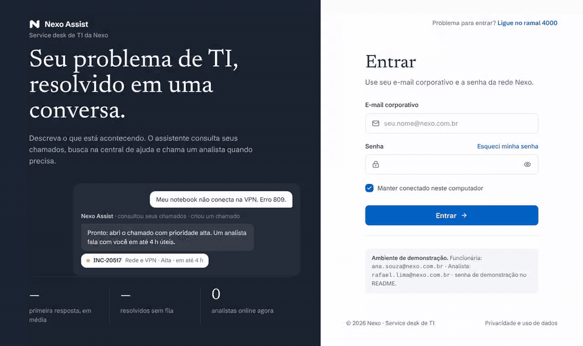
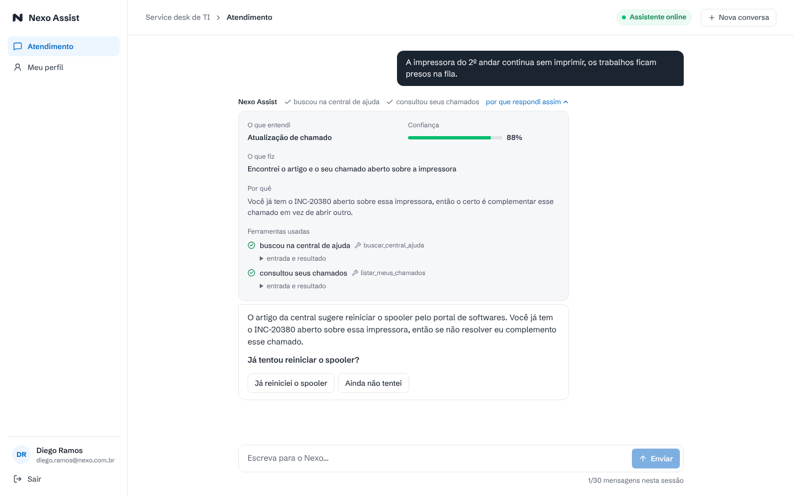
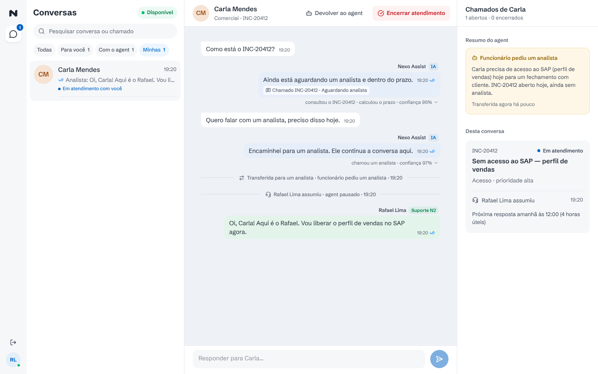
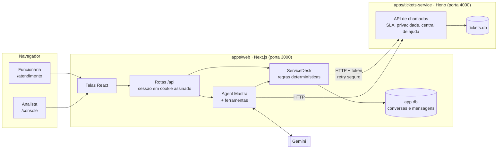
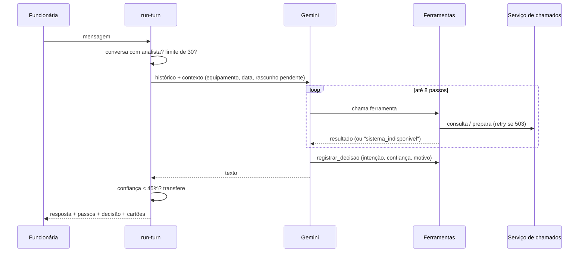

# Nexo Assist

[](https://github.com/Jeane-Cristina/nexo-assist/actions/workflows/ci.yml)

Agent de atendimento do service desk de TI da Nexo. O funcionário descreve o problema num chat e o agent decide o que fazer: responder uma dúvida com a central de ajuda, consultar ou atualizar um chamado, abrir um chamado novo (sempre com confirmação) ou chamar um analista. O analista acompanha tudo num console, assume a conversa com o agent pausado e devolve quando terminar.

Cada resposta do agent mostra o que ele fez e por quê: os passos executados, a intenção entendida, a confiança e as regras do service desk aplicadas.



<sub>Gravado no modo de demonstração (`LLM_MODEL=demo/roteiro`), que troca o Gemini por respostas roteirizadas. Com o modelo real, o fluxo e as telas são os mesmos.</sub>

## Sumário

- [Como rodar](#como-rodar)
- [Roteiro para testar](#roteiro-para-testar)
- [O que o PRD pede e onde está](#o-que-o-prd-pede-e-onde-está)
- [Arquitetura](#arquitetura)
- [Como o agent decide](#como-o-agent-decide)
- [Decisões e trade-offs](#decisões-e-trade-offs)
- [Testes e avaliação do agent](#testes-e-avaliação-do-agent)
- [Limitações e o que eu faria com mais tempo](#limitações-e-o-que-eu-faria-com-mais-tempo)

## Como rodar

Requisitos: **Node 20.19+** (recomendado 22) e **pnpm 10+** (`npm install -g pnpm`). Você também precisa de uma chave gratuita do Gemini, criada em [aistudio.google.com](https://aistudio.google.com) → *Get API key*.

```bash
pnpm install

# 1. Variáveis de ambiente. Use o MESMO SERVICE_TOKEN nos dois arquivos.
cp apps/tickets-service/.env.example apps/tickets-service/.env
cp apps/web/.env.example apps/web/.env.local
#    Em apps/web/.env.local, preencha GOOGLE_GENERATIVE_AI_API_KEY e SESSION_SECRET (32+ caracteres).

# 2. Sobe o serviço de chamados (porta 4000) e o app (porta 3000) juntos.
#    No primeiro boot, o serviço de chamados cria e popula o banco.
pnpm dev
```

Se preferir ver os logs separados, use um terminal para `pnpm --filter tickets-service dev` e outro para `pnpm --filter web dev`.

**Sem chave do Gemini?** Coloque `LLM_MODEL=demo/roteiro` no `apps/web/.env.local`. O agent passa a usar respostas roteirizadas para duas mensagens ("O Excel fecha sozinho" e "Quero falar com um analista"). Dá para ver as telas, o rascunho, a confirmação e o console funcionando, mas não é a IA decidindo.

Abra **http://localhost:3000**. A senha de demonstração é a mesma para todos (`DEMO_PASSWORD`, padrão `nexo123`):

| Perfil | E-mail | Situação nos dados de exemplo |
|---|---|---|
| Funcionária | `ana.souza@nexo.com.br` | Notebook com Windows 11; 3 chamados abertos (1 vencido), 1 resolvido há 4 dias |
| Funcionária | `carla.mendes@nexo.com.br` | Chamado de acesso ao SAP aberto hoje |
| Analista | `rafael.lima@nexo.com.br` | Suporte N2 |
| Analista | `juliana.costa@nexo.com.br` | Suporte N1 |

### Comandos úteis

| Comando | O que faz |
|---|---|
| `pnpm test` | Testes unitários e de integração (não precisa de chave nem de servidor rodando) |
| `pnpm test:coverage` | Os mesmos testes, com relatório de cobertura |
| `pnpm e2e` | Testes ponta a ponta no navegador (sobe os dois serviços sozinho, no modo de demonstração) |
| `pnpm typecheck` | TypeScript estrito nos dois projetos |
| `pnpm seed` | Recria os dados de exemplo (as datas são relativas a "agora") |
| `pnpm --filter web chat` | Conversa com o agent pelo terminal, sem as telas |
| `pnpm --filter web eval` | Roda os cenários do PRD contra o modelo real e mostra o placar |

### Variáveis de ambiente

**`apps/web/.env.local`**

| Variável | Para quê |
|---|---|
| `LLM_MODEL` | Modelo no formato `provedor/modelo` (padrão `google/gemini-3.5-flash-lite`). `demo/roteiro` liga o modo de demonstração |
| `LLM_FALLBACK_MODEL` | Modelo reserva, usado quando o principal está sobrecarregado ou sem cota |
| `GOOGLE_GENERATIVE_AI_API_KEY` | Chave do Gemini. Para outro provedor, troque a chave e o `LLM_MODEL` |
| `TICKETS_SERVICE_URL` / `SERVICE_TOKEN` | Endereço do serviço de chamados e o token compartilhado com ele |
| `APP_DB_URL` / `APP_DB_AUTH_TOKEN` | Banco do app: arquivo SQLite local ou URL do Turso |
| `SESSION_SECRET` | Chave que assina o cookie de sessão |
| `DEMO_PASSWORD` | Senha de demonstração |

**`apps/tickets-service/.env`**

| Variável | Para quê |
|---|---|
| `PORT`, `SERVICE_TOKEN` | Porta e token (o mesmo do app) |
| `TICKETS_DB_URL` / `TICKETS_DB_AUTH_TOKEN` | Banco dos chamados |
| `LEGACY_FAILURE_RATE` | Chance de cada requisição falhar com 503 (padrão 10%) |
| `LEGACY_MAX_LATENCY_MS` | Latência aleatória máxima (padrão 600 ms) |

## Roteiro para testar

Use duas janelas: uma normal (funcionária) e uma anônima (analista).

1. **Dúvida que vira chamado.** Como Ana, envie *"Meu notebook não conecta na VPN. Erro 809."*. O agent busca na central e percebe que o artigo vale só para Windows 10, enquanto o notebook dela usa Windows 11. Então pergunta quem é afetado.
2. **Prioridade calculada.** Responda *"Só eu, tenho reunião com um cliente às 14h"*. O rascunho sai com prioridade **alta** por causa do compromisso de hoje. Em **Editar**, desmarque o compromisso: a prioridade cai para **média** e o prazo é recalculado.
3. **Transparência.** Clique em *por que respondi assim* para ver intenção, confiança, regras aplicadas e cada ferramenta com entrada e resultado.
4. **Confirmação.** Clique em **Confirmar** (ou Ctrl/⌘ + Enter). Só aí o chamado é criado.
5. **Consulta e prazo vencido.** Pergunte *"Qual o status do meu chamado?"*, escolha o INC-20311 na lista e veja o prazo vencido e a oferta de analista.
6. **Transferência.** Peça um analista. A conversa fica *aguardando analista* e o agent para de responder.
7. **Console.** Como Rafael, abra a conversa em **Para você**, leia o resumo que o agent deixou, clique em **Assumir atendimento** e responda. A mensagem chega na janela da Ana em até 3 segundos. Depois, **Devolver ao agent**.
8. **Regras.** Teste *"Como peço minhas férias?"* (fora do escopo de TI), *"Me mostre o INC-20412"* (chamado de outra pessoa) e *"A senha do SAP bloqueou de novo"* (reabre o INC-20150 em vez de duplicar).

| Transparência da decisão | Console do analista |
|---|---|
|  |  |

## O que o PRD pede e onde está

| Requisito | Como foi feito | Onde |
|---|---|---|
| Identificação e chat | Login com e-mail corporativo; chat com contador de 30 mensagens por sessão | `app/login`, `components/chat` |
| Decidir a cada mensagem | Agent Mastra com 9 ferramentas; o modelo escolhe a ação | `server/agent` |
| Serviço de chamados separado | API REST própria, com banco próprio; o agent só fala com ela por HTTP | `apps/tickets-service` |
| Legado instável | O serviço falha (503) e atrasa de propósito; o cliente faz retry seguro e o agent responde com honestidade quando não dá | `http/legacy-instability.ts`, `tickets/client.ts` |
| Rascunho antes de criar | Cria ou atualiza só depois da confirmação; o código impede confirmar no mesmo turno em que o rascunho foi montado | `service-desk.ts`, `agent/tools.ts` |
| Prioridade e prazo | Impacto × urgência em código; prazos em horas e dias úteis, contados da última atualização do suporte | `agent/triage.ts`, `domain/sla.ts` |
| Sem duplicidade | Antes de montar o rascunho, procura chamado da mesma categoria; aberto é complementado, resolvido há até 7 dias é reaberto | `agent/tools.ts`, `domain/rules.ts` |
| Transferência | Quando o funcionário pede, em caso crítico, em chamado vencido aceito, ou com confiança abaixo de 45%; o agent pausa | `agent/run-turn.ts`, `service-desk.ts` |
| Privacidade | As ferramentas não recebem e-mail; o serviço responde 404 para chamado de outra pessoa | `agent/tools.ts`, `domain/tickets.ts` |
| Escopo | RH, financeiro e facilities são redirecionados, sem chamado | `agent/instructions.ts` |
| Console do analista | Filtros, histórico, assumir com o agent pausado, devolver, encerrar, painel com os chamados da pessoa | `components/console`, `chat/analyst-console.ts` |
| Visibilidade das decisões | Passos acima de cada resposta e o painel *por que respondi assim* | `agent/recorder.ts`, `chat/decision-panel.tsx` |
| Continuar outro dia | Conversas persistidas; ao entrar, a conversa em aberto é retomada | `conversations/store.ts` |

## Arquitetura



São **dois processos**:

- **`tickets-service`** faz o papel do sistema legado. Ele é dono das regras dos chamados (prazos, reabertura, quem vê o quê) e não sabe que existe um agent.
- **`web`** junta as telas, as rotas de API e o agent num Next.js só. Conversa, transferência e pausa do agent são conceitos do atendimento, não do legado, então ficam no banco do próprio app.

Os dois bancos usam libSQL: arquivo SQLite local para rodar e Turso no deploy, com o mesmo código.

```
apps/
├── tickets-service/src/
│   ├── domain/      regras: SLA em horário útil, reabertura, privacidade, central de ajuda
│   ├── db/          SQL, seed com datas relativas a "agora"
│   └── http/        rotas Hono, autenticação entre serviços, instabilidade simulada
└── web/src/
    ├── app/         páginas (login, atendimento, perfil, console) e rotas /api
    ├── components/  chat (mensagens, cartões, painel de decisão) e console
    └── server/
        ├── agent/          instruções, ferramentas, prioridade, orquestração do turno
        ├── chat/           casos de uso da funcionária e do analista
        ├── conversations/  modelo e persistência das conversas
        ├── tickets/        cliente HTTP do legado, com retry
        ├── auth/           sessão
        └── service-desk.ts ações sem IA: confirmar, transferir, assumir
```

## Como o agent decide

### Um turno



### Ferramentas

| Ferramenta | O que faz |
|---|---|
| `buscar_central_ajuda` | Busca artigos; o modelo compara as condições do artigo com o equipamento da pessoa |
| `listar_meus_chamados` / `consultar_chamado` | Chamados da própria pessoa, com status, último movimento e prazo |
| `preparar_rascunho_chamado` | Checa duplicidade, calcula a prioridade, consulta o prazo e monta o rascunho. **Não cria** |
| `preparar_atualizacao` | Complemento (aberto) ou reabertura (resolvido há até 7 dias), com reclassificação opcional |
| `confirmar_acao_pendente` / `cancelar_acao_pendente` | Executa ou descarta o rascunho que a pessoa viu |
| `transferir_para_analista` | Pausa o agent e deixa um resumo para o analista |
| `registrar_decisao` | Intenção, ação, confiança, motivo e opções rápidas do turno |

### A IA decide, o código garante

O modelo entende a conversa e escolhe a ferramenta. Tudo o que não pode dar errado é garantido em código, porque o modelo pode errar:

| Risco | Barreira |
|---|---|
| Expor chamado de outra pessoa | As ferramentas são criadas por turno com o funcionário da sessão; nenhuma recebe e-mail como parâmetro. O serviço responde 404, e não 403, para nem confirmar que o número existe |
| Criar chamado sem a pessoa ver | O rascunho fica salvo na conversa; a confirmação precisa citar o mesmo id e acontecer num turno posterior |
| Prioridade "no chute" | O modelo informa os fatos (quem é afetado, se está parado, se há compromisso hoje) e `triage.ts` aplica a tabela do Anexo A |
| Duplicar chamado | A ferramenta procura chamados parecidos antes de montar o rascunho; o legado aceita chave de idempotência, então um retry nunca cria dois |
| Agent inseguro respondendo mesmo assim | Confiança abaixo de 45% transfere automaticamente, mesmo que o modelo não peça |
| Caso crítico esperando o agent | Chamado crítico confirmado vai direto para um analista |
| Agent falando por cima do analista | Com a conversa transferida, a mensagem do funcionário é salva e o modelo nem é chamado |

### Transparência

O painel *por que respondi assim* não é uma explicação escrita depois pelo modelo. Ele mostra o que **foi executado**:

- **Passos:** cada ferramenta anota o que fez ("consultou o INC-20311", "calculou o prazo"), com entrada e resultado.
- **Regras aplicadas:** o código registra as regras de negócio que pesaram ("Prioridade alta: há um compromisso hoje", "Sem duplicidade: o INC-20150 foi resolvido há até 7 dias, então é reaberto").
- **Intervenções automáticas:** quando o código corrige o modelo ("transferido automaticamente: confiança 41%").
- **Intenção, confiança e motivo:** os únicos campos que vêm do modelo, via `registrar_decisao`.

O analista vê o mesmo painel em cada resposta do agent no console, e a confiança aparece na lista de conversas ("Agent pediu ajuda · confiança 41%").

## Decisões e trade-offs

| Decisão | Por quê | Custo |
|---|---|---|
| **Mastra** com ferramentas criadas por turno | O funcionário fica preso no closure, então a privacidade não depende do prompt; o agent é testável com um modelo roteirizado | Um `Agent` por mensagem (barato) e sem a memória embutida do Mastra |
| **Histórico no banco do app**, não na memória do Mastra | O console precisa das mensagens do analista e dos eventos; uma fonte de verdade só | Monto o contexto manualmente (últimas 20 mensagens) |
| **Gemini 3.5 Flash-Lite + reserva 3.1 Flash-Lite** | Plano gratuito: 15 req/min e 500/dia, contra 20/dia dos Flash. Cada mensagem usa de 3 a 5 chamadas | Modelo mais simples, que varia mais entre execuções. Trocar de provedor é uma linha no `.env` |
| **Modelo reserva só se nenhuma ferramenta rodou** | Refazer um turno pela metade poderia repetir efeitos | Se o provedor cair no meio do turno, a pessoa recebe "tente de novo" |
| **Retry seguro no cliente do legado** | GET sempre; POST só se o legado respondeu 503 antes de processar ou se há chave de idempotência | Na pior hipótese, uma falha de rede no meio de um POST sem chave vira "tente de novo" |
| **libSQL (SQLite local / Turso)** | Roda com `pnpm install` e nada mais; mesmo código no deploy | Sem migrações versionadas (`CREATE TABLE IF NOT EXISTS`) |
| **Sessão em cookie httpOnly assinado** | Sem estado no servidor; adulterar e-mail ou papel invalida a assinatura | Senha única de demonstração; em produção seria SSO corporativo |
| **Polling (3–4 s)** em vez de WebSocket | Funciona em qualquer deploy serverless, sem infraestrutura extra | Até 3 s de atraso e requisições extras |
| **Resposta inteira, sem streaming** | Passos, decisão e cartões só ficam prontos no fim do turno | A pessoa espera de 3 a 5 s com o indicador "analisando…" |
| **Busca lexical na central** | Com 9 artigos, é previsível e explicável | Não entende sinônimos distantes |
| **Métricas do login calculadas dos dados** | O protótipo mostra números; preferi não inventar | Num banco vazio aparece "—" |

## Testes e avaliação do agent

Três camadas, todas rodando no [CI](.github/workflows/ci.yml) a cada push:

| Camada | Quantidade | Cobertura |
|---|---|---|
| Serviço de chamados (`pnpm test`) | 38 testes | 92% das linhas |
| Back do app: agent, regras, chat e console (`pnpm test`) | 62 testes | 89% das linhas |
| Telas, ponta a ponta no navegador (`pnpm e2e`) | 2 fluxos com Playwright | — |

Nenhum deles precisa de chave nem de rede.

- **Regras do legado:** prazo em horário útil (virada de dia, fim de semana, fora do expediente), reabertura em até 7 dias, privacidade, idempotência e instabilidade.
- **Orquestração do agent** com um modelo roteirizado no lugar do LLM, contra o serviço de chamados real em memória. Testa o que existe em volta do modelo: ferramentas, barreiras, persistência e transparência. Exemplos:
  - não deixa confirmar no mesmo turno;
  - confiança baixa transfere;
  - conversa transferida não chama o modelo;
  - modelo reserva entra só se nenhuma ferramenta rodou.
- **Rotas e telas:** a Carla não usa a conversa da Ana nem sabendo o id; só quem assumiu responde; o rascunho continua salvo se o legado cair na confirmação.
- **Sessão:** cookie adulterado (trocar e-mail, virar analista) é rejeitado.
- **Ponta a ponta:** a Ana abre um chamado, confere o painel *por que respondi assim*, confirma e pede um analista; o Rafael assume e responde no console; a resposta aparece para a Ana; ele devolve e o agent volta. Também confere que funcionário não entra no console. Roda no modo de demonstração, para não depender do Gemini.

**Avaliação com o modelo real** (`pnpm --filter web eval`): 8 cenários do PRD com 28 verificações. Os cenários são VPN no Windows 11, rascunho com prioridade alta, consulta com vários chamados, chamado vencido, privacidade com tentativa de injeção de instruções, assunto de RH, dúvida resolvida pela central e pedido de analista.

A primeira rodada passou em todas as verificações da época. Ao ler as respostas, apareceram problemas que as verificações não pegavam:
- opções rápidas que não respondiam à pergunta feita;
- motivo escrito em terceira pessoa;
- lista de chamados repetida no texto.

Corrigi o prompt e transformei cada problema numa verificação nova. Uma resposta de erro do modelo (cota excedida, por exemplo) conta como falha do cenário, para não "passar" por acidente.

## Limitações e o que eu faria com mais tempo

**Limitações conhecidas**
- O cálculo de prazo não considera feriados (só fins de semana e o expediente das 8h às 18h).
- Login de demonstração com senha única; não há redefinição de senha.
- O modelo gratuito tem cota baixa. Com vários avaliadores ao mesmo tempo, pode aparecer "o serviço de IA está sobrecarregado".
- A central de ajuda tem 9 artigos e busca por palavras.

**Com mais tempo**
- Streaming da resposta, com os passos aparecendo conforme as ferramentas rodam.
- SSE ou WebSocket no lugar do polling.
- Busca semântica (embeddings) na central de ajuda.
- Calendário de feriados no SLA.
- SSO corporativo (OAuth/Entra ID) no lugar da senha de demonstração.
- Eval rodando no CI a cada mudança de prompt, com histórico do placar.
- Observabilidade do agent (traces do Mastra) e métricas de custo por conversa.
- Notificação ao analista quando uma conversa entra na fila.
